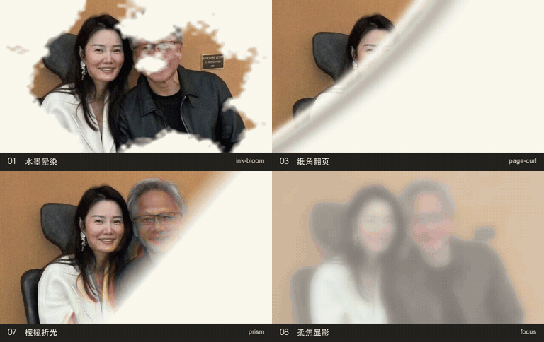
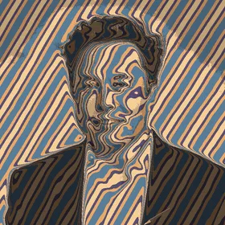
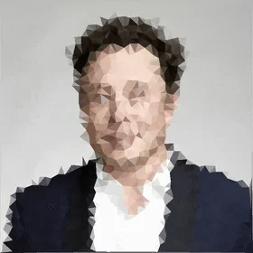

# ArtInMotion

[简体中文](README.md) · [Agent instructions](SKILL.md) · [Transition catalog](references/transitions.md)

**Turn a photograph into a 24-second drawing film.** Show the finished piece, return to the paper, and let the viewer follow the first pencil stroke into the layers of color. ArtInMotion samples color, edges and stroke direction from your reference and renders every mark locally. The same marks produce a movie with sound and a clean still. No image-generation model or API key is needed.

[](demo/transition-atlas.mp4)

**[Compare 20 styles on one Musk portrait · 30 sec](demo/musk-style-atlas.mp4)** · **[Browse all 68 transitions in 60 seconds](demo/transition-atlas.mp4)** · **[Watch the 24-second colored-pencil film with sound](demo/ribbon-portrait.mp4)**

## Make your first film with a prompt

Attach a photo in Codex or another assistant that can run local skills, then send this prompt.

```text
Use $art-in-motion to turn my attached photo into a 24-second colored-pencil film. Keep the original framing.
If the skill is missing, install it from https://github.com/DeaglePC/ArtInMotion and set up its dependencies first.
Show the finished drawing, then transition to blank paper. Keep the pencil tip visible as it draws.
Add pencil sounds to the first three strokes, then let the piano play on its own.
Give me the MP4 film and the finished drawing as a PNG.
```

To try another style, follow up with “Use the same photo for a second version in style 06, watercolor, with richer color.”

## Watch the 14 full-length films

Watch the same Musk portrait take shape in each animated preview. Click a preview or style name for the full 24-second film with sound. To try a style on your own photo, tell the assistant its number.

<table>
  <tr>
    <td align="center">
      <a href="https://deaglepc.github.io/ArtInMotion/03-charcoal.mp4"><br><strong>03 · Charcoal tonal drawing</strong></a>
    </td>
    <td align="center">
      <a href="https://deaglepc.github.io/ArtInMotion/05-ink-wash.mp4"><br><strong>05 · Monochrome ink wash</strong></a>
    </td>
  </tr>
  <tr>
    <td align="center">
      <a href="https://deaglepc.github.io/ArtInMotion/07-gongbi.mp4"><br><strong>07 · Gongbi painting in rich color</strong></a>
    </td>
    <td align="center">
      <a href="https://deaglepc.github.io/ArtInMotion/08-realist.mp4"><br><strong>08 · Realist painting</strong></a>
    </td>
  </tr>
  <tr>
    <td align="center">
      <a href="https://deaglepc.github.io/ArtInMotion/09-impasto.mp4"><br><strong>09 · Impasto brushwork</strong></a>
    </td>
    <td align="center">
      <a href="https://deaglepc.github.io/ArtInMotion/10-pastel.mp4"><br><strong>10 · Soft pastel</strong></a>
    </td>
  </tr>
  <tr>
    <td align="center">
      <a href="https://deaglepc.github.io/ArtInMotion/11-crayon.mp4"><br><strong>11 · Crayon and oil pastel</strong></a>
    </td>
    <td align="center">
      <a href="https://deaglepc.github.io/ArtInMotion/12-flat.mp4"><br><strong>12 · Flat-color illustration and comics</strong></a>
    </td>
  </tr>
  <tr>
    <td align="center">
      <a href="https://deaglepc.github.io/ArtInMotion/13-woodcut.mp4"><br><strong>13 · Woodcut and silhouette</strong></a>
    </td>
    <td align="center">
      <a href="https://deaglepc.github.io/ArtInMotion/15-stipple.mp4"><br><strong>15 · Stippling and halftone</strong></a>
    </td>
  </tr>
  <tr>
    <td align="center">
      <a href="https://deaglepc.github.io/ArtInMotion/16-collage.mp4"><br><strong>16 · Collage and mosaic</strong></a>
    </td>
    <td align="center">
      <a href="https://deaglepc.github.io/ArtInMotion/18-marbling.mp4"><br><strong>18 · Fluid painting and marbling</strong></a>
    </td>
  </tr>
  <tr>
    <td align="center">
      <a href="https://deaglepc.github.io/ArtInMotion/19-facets.mp4"><br><strong>19 · Geometric facets</strong></a>
    </td>
    <td align="center">
      <a href="https://deaglepc.github.io/ArtInMotion/20-pixel.mp4"><br><strong>20 · Pixel and character art (pixel demo)</strong></a>
    </td>
  </tr>
</table>

The films and animated previews redraw a [photograph by Duncan.Hull / The Royal Society](https://commons.wikimedia.org/wiki/File:Elon_Musk_Royal_Society.jpg) and are shared under [CC BY-SA 4.0](https://creativecommons.org/licenses/by-sa/4.0/).

## Find an opening for your film

Each demo uses the same portrait so you can compare the transitions directly. The numbers on screen work as selectors in the renderer.

| Demo | Runtime | What to watch for |
|---|---:|---|
| [The complete transition atlas](demo/transition-atlas.mp4) | 60 sec | Four effects play side by side on each of 17 screens. Pick an entrance and an exit by number. |
| [Ten transitions designed for paintings](demo/painting-transitions.mp4) | 31 sec | See each effect at full frame, from the feathered edge of an ink bloom to the shadow beneath a curling page. |
| [Ribbon reveal · finished pencil film](demo/ribbon-portrait.mp4) | 24 sec | Alternating ribbons reveal the portrait. Listen for pencil on paper during the first four strokes and solo piano through the time-lapse. |
| [Finished-art preview · straight cut](demo/portrait-preview.mp4) | 24 sec | An earlier edit that cuts directly from the finished portrait to blank paper. Compare its pacing with the ribbon reveal. |

Both renderers accept a number, an English ID or a Chinese name. Choose one effect for both directions, or pair an ink-bloom entrance with a soft-focus exit. Omit both choices to draw one at random from the effects available on your machine. The catalog includes 10 art-specific transitions and 58 FFmpeg presets. [Browse the numbered catalog](references/transitions.md)

## One reference, 20 ways to draw it

[](demo/musk-style-atlas.mp4)

**[Play the 30-second style comparison](demo/musk-style-atlas.mp4)** · [View all 20 presets on a second reference](demo/styles.jpg)

One Elon Musk photograph, one crop. Each page opens on four finished portraits, then shows them being drawn side by side. Jump to **0:00** for 01–04, **0:06** for 05–08, **0:12** for 09–12, **0:18** for 13–16, or **0:24** for 17–20. Use the number beside any portrait to render your own photo in that style, for example “Draw this photo in style 04, colored pencil.”

The comparison video and GIF adapt *Elon Musk Royal Society.jpg* by Duncan.Hull / The Royal Society. The photo was cropped, rendered in each medium and arranged in panels. Both adaptations are shared under CC BY-SA 4.0. [Source photograph and credit](https://commons.wikimedia.org/wiki/File:Elon_Musk_Royal_Society.jpg) · [CC BY-SA 4.0](https://creativecommons.org/licenses/by-sa/4.0/)

Impasto builds volume with overlapping strokes. Hatching builds shadows with crossing lines. Collage places pieces of color one at a time. The renderer preserves the framing of landscape and portrait photos and exports stills as PNG, JPEG or WebP.

<details>
<summary>Show all 20 drawing preset IDs</summary>

| No. | Preset | No. | Preset |
|---|---|---|---|
|01|contour|11|crayon|
|02|hatching|12|flat|
|03|charcoal|13|woodcut|
|04|colored-pencil|14|block-print|
|05|ink-wash|15|stipple|
|06|watercolor|16|collage|
|07|gongbi|17|sand|
|08|realist|18|marbling|
|09|impasto|19|facets|
|10|pastel|20|pixel|

</details>

Run `--list-styles` for the drawing presets or `--list-transitions` for the transitions supported by your FFmpeg build. A default film runs 24 seconds at 30 fps, with 960 pixels on the long edge. The opening preview and transitions fit inside the requested duration.

| What to change | Option |
|---|---|
| Spend six seconds on the opening strokes | `--opening-seconds 6` |
| Deepen the pigment or increase the resolution | `--pigment 1.25`, `--size 1920` |
| Start on blank paper or hide the drawing tool | `--no-preview`, `--no-tool` |
| Keep drawing sounds only, supply music, or mute the film | `--no-music`, `--music music.wav`, `--silent` |
| Reproduce the marks and piano score | `--seed 42`. Specify the transitions to reproduce the opening, too. |

New films play drawing sounds only for the first three slow marks. The sound stops when the tool lifts, and the backing music plays alone from the fourth mark to the end. Colored pencil uses recorded pencil on paper. Other presets use their own brush or placement sounds. The piano accompaniment is synthesized locally. [Pencil recording and CC0 dedication](https://freesound.org/people/zakkolar/sounds/431438/)

## Classic portrait film and custom mark plans

The classic oil renderer moves in for a close-up and pulls back to reveal the full painting, with a stroke counter and score. Try asking “Make a classic vertical oil painting from this photo. Move in on the eyes, then pull back to show the finished portrait.” [Watch the classic oil film](demo/jensen-huang.mp4) · [GIF preview](demo/preview.gif) · [Rendering guide](references/classic-oil.md)

For lettering, ornamental patterns or a specific drawing order, author a JSON mark plan and pass it to the renderer with `--plan`. [Technique guide](references/media.md) · [Mark plan format](references/marks.md)

If you see a style you want to try on your next photo, **star ArtInMotion** to keep the transition atlas and drawing presets handy.
