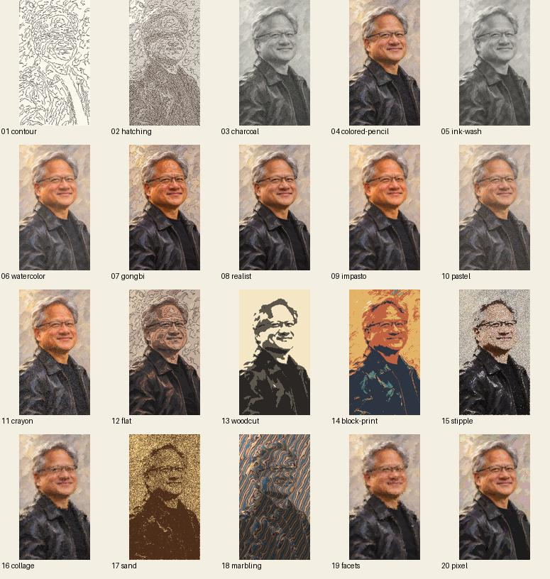

# ArtInMotion

[简体中文](README.md) · [Agent instructions](SKILL.md)

Render a photograph into a **drawing-process MP4**, a **clean PNG, JPEG or WebP**, or both from the same sequence of marks. The renderer samples color, edges and local direction from the source and builds the canvas locally. No image-generation model, API key or network service is needed at render time.



## Give this to your agent

> Install https://github.com/DeaglePC/ArtInMotion, read SKILL.md and set up its dependencies. Use my attached original photo to draw a colored-pencil portrait. Keep the framing, start slowly, and show the pencil tip throughout a 24-second movie. Run the renderer and return both the MP4 and the clean PNG.

After installation, try “Use `$art-in-motion` to render this photo in watercolor and return the finished image.” Any assistant with local command execution can run the same CLI from a checkout. It supports portraits, groups, landscapes and other subjects without face coordinates.

## Install and try it

The commands below install ArtInMotion in the Codex directory named for the skill ID in `SKILL.md`, `art-in-motion`. Other agents can clone into their own workspace.

```sh
git clone https://github.com/DeaglePC/ArtInMotion.git ~/.codex/skills/art-in-motion
cd ~/.codex/skills/art-in-motion
```

Use Python 3.11 or 3.12. Video also needs FFmpeg with libx264 on PATH. Still-image export needs only the Python dependencies. From the repository root:

```sh
python -m venv .venv
source .venv/bin/activate
# Windows PowerShell: .\.venv\Scripts\Activate.ps1
python -m pip install -r requirements.txt
python scripts/render_art.py --list-styles
python scripts/render_art.py --input demo/jensen-huang.png --style watercolor --size 480 --fps 12 --seconds 3 --image renders/test.png --video renders/test.mp4
```

## Render

```sh
python scripts/render_art.py --input photo.jpg --style colored-pencil --video renders/pencil.mp4 --image renders/pencil.png
python scripts/render_art.py --input photo.jpg --style 02 --image renders/hatching.webp
python scripts/render_art.py --input photo.jpg --style block-print --seconds 10 --music music.wav --video renders/print.mp4
```

Defaults are 24 seconds, 30 fps and 960 pixels on the long edge. EXIF orientation is applied and the aspect ratio is preserved to the nearest even dimensions. Set `--size 1920` for a larger canvas and `--seed` for repeatability. The first marks are drawn slowly, followed by accelerated work and a final hold. Set `--opening-seconds 6` to spend six seconds on the opening marks and `--pigment 1.25` for denser pigment when drawing from a photo. The tool stays visible, with a placement cursor for collage, sand and pixels. Use `--no-tool` to hide it. All 20 presets mix medium-specific drawing sounds with a soft synthesized piano score. Contact follows the mark timeline and the final hold leaves only music. Use `--no-music` for drawing sounds alone, `--music FILE` to replace the piano, or `--silent` for a silent MP4. The seed also controls the score. Choose unused output names. See `--help` for options.

Colored pencil plays recorded pencil-on-paper sounds only during the slow opening strokes. The accelerated passage has backing music alone. Set `--opening-seconds 0` for a music-only pencil movie. The recording is available under CC0. [zakkolar · pencil.wav](https://freesound.org/people/zakkolar/sounds/431438/)

## Presets and authored media

| No. | Preset | No. | Preset |
|---|---|---|---|
|01|contour|11|crayon|
|02|hatching|12|flat|
|03|charcoal|13|woodcut|
|04|colored-pencil|14|block-print|
|05|ink-wash|15|stipple|
|06|watercolor|16|collage|
|07|gongbi|17|sand|
|08|realist|18|marbling|
|09|impasto|19|facets|
|10|pastel|20|pixel|

Each preset implements one procedural interpretation of a medium. Select it by ID, two-digit number or the full Chinese label from `--list-styles`. For an original composition from text or another technique, an agent can author an ordered [mark plan](references/marks.md) and render it with `--plan`. The same reference describes how to add a photo-driven generator. The [technique guide](references/media.md) maps additional media and describes the marks needed for custom treatments.

## Classic oil movie

The original portrait-format oil renderer with camera moves, a stroke counter and synchronized sound remains available. Install Chromium with `python -m playwright install chromium`, then run `python scripts/paint_video.py demo/jensen-huang.png renders/classic.mp4`. It requires WebGL 2. See the [original movie](demo/jensen-huang.mp4) and [classic options](references/classic-oil.md).
