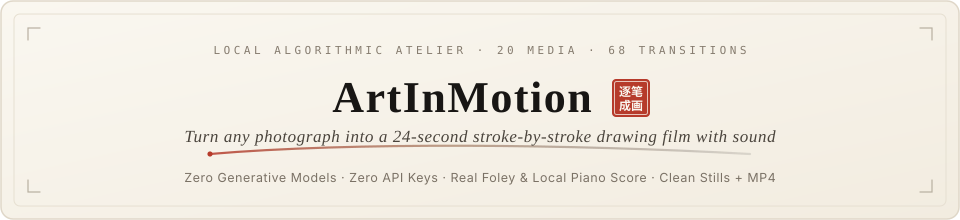
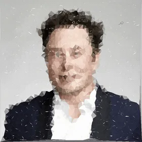
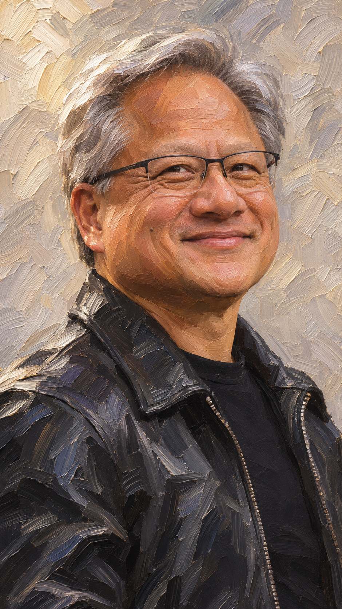

<div align="center">

<picture>
  <source media="(prefers-color-scheme: dark)" srcset="assets/banner-en-dark.svg">
  <source media="(prefers-color-scheme: light)" srcset="assets/banner-en-light.svg">
  
</picture>

<br>

[](https://deaglepc.github.io/ArtInMotion/)
[](#one-reference-20-ways-to-draw-it)
[](#find-an-opening-for-your-film)
[](#quick-start)
[](requirements.txt)

**[Live Interactive Gallery](https://deaglepc.github.io/ArtInMotion/)** · **[简体中文](README.md)** · **[Quick Start](#quick-start)** · **[14 Full Films](#watch-the-14-full-length-films)** · **[20 Media](#one-reference-20-ways-to-draw-it)** · **[68 Transitions](#find-an-opening-for-your-film)** · **[3D Classic Oil](#classic-3d-oil-portrait--custom-mark-plans)** · **[Agent Skill](SKILL.md)**

<br>

**Turn a photograph into a 24-second stroke-by-stroke drawing film.**<br>
Open on the finished artwork, return to blank paper, and follow the very first mark into layered color.<br>
ArtInMotion derives contours, palette, and stroke flow directly from your photo on-device—exporting both a scored MP4 film and a clean still with zero generative models or API keys.

<br>

[](demo/transition-atlas.mp4)

**[Compare 20 styles on one portrait · 30s](demo/musk-style-atlas.mp4)**　·　**[Browse all 68 transitions · 60s](demo/transition-atlas.mp4)**　·　**[Listen to the colored-pencil film · 24s](demo/ribbon-portrait.mp4)**　·　**[Enter Online Screening Room ↗](https://deaglepc.github.io/ArtInMotion/)**

</div>

---

## Why ArtInMotion

<table>
  <tr>
    <td width="50%" valign="top">
      <strong>100% Local Algorithmic Marks · Zero Hallucination</strong><br>
      No cloud diffusion models or API keys. Every stroke is computed directly from your reference photo’s edge curvature, tonal gradients, and local color—preserving true likeness and framing.
    </td>
    <td width="50%" valign="top">
      <strong>20 Tactile Media × 68 Transitions</strong><br>
      From colored pencil, sumi ink wash, and gongbi to impasto oil, woodcut, stippling, and backlit sand—paired with 10 bespoke painting transitions and 58 FFmpeg xfade presets.
    </td>
  </tr>
  <tr>
    <td width="50%" valign="top">
      <strong>Restrained Cinema & Acoustic Craft</strong><br>
      Each film reveals the finished piece for 1.2s before returning to paper. Synchronized foley plays only on the first three slow strokes, giving way to a locally synthesized solo piano score.
    </td>
    <td width="50%" valign="top">
      <strong>Agent-Ready Skill + Reproducible CLI</strong><br>
      Generate films with a single natural-language prompt in Codex, Claude Code, or Antigravity—or run deterministic Python CLI commands with custom seeds and JSON mark plans.
    </td>
  </tr>
</table>

---

## Quick Start

### Option 1: Make your first film with a prompt (Recommended)

Attach any photo in Codex or another assistant capable of running local skills, then paste:

```text
Use $art-in-motion to turn my attached photo into a 24-second colored-pencil film. Keep the original framing.
If the skill is missing, install it from https://github.com/DeaglePC/ArtInMotion and set up its dependencies first.
Show the finished drawing, then transition to blank paper. Keep the pencil tip visible as it draws.
Add pencil sounds to the first three strokes, then let the piano play on its own.
Give me the MP4 film and the finished drawing as a PNG.
```

> **Try another medium**: Follow up with *“Use the same photo for a second version in style 06, watercolor, with richer color and an ink-bloom entrance”*, or build a custom prompt interactively in the **[Online Prompt Studio](https://deaglepc.github.io/ArtInMotion/#studio)**.

<details>
<summary><strong>Option 2: Run directly via Local Python CLI (Click to expand)</strong></summary>

Ensure **FFmpeg** (with `libx264` and `aac` encoders) is available on `PATH`, then set up a Python 3.11+ environment:

```bash
git clone https://github.com/DeaglePC/ArtInMotion.git
cd ArtInMotion
python -m venv .venv
source .venv/bin/activate  # On Windows PowerShell: .\.venv\Scripts\Activate.ps1
pip install -r requirements.txt

# Render a 24-second colored-pencil film + clean PNG still
python scripts/render_art.py --input "photo.jpg" --style colored-pencil --seconds 24 --video "output.mp4" --image "output.png"

# Inspect all 20 presets and available transitions
python scripts/render_art.py --list-styles
python scripts/render_art.py --list-transitions
```

</details>

---

## Watch the 14 Full-Length Films

Watch the same portrait take shape across 14 distinct grounds and tools. **Click any animated preview or title to play the full 24-second MP4 with sound.** Tell your assistant the preset number to apply that style to your own photo.

<table>
  <tr>
    <td align="center" width="25%">
      <a href="https://deaglepc.github.io/ArtInMotion/03-charcoal.mp4"><br><strong>03 · Charcoal Tonal</strong></a><br><sub><code>charcoal</code> · Chalk on tooth</sub>
    </td>
    <td align="center" width="25%">
      <a href="https://deaglepc.github.io/ArtInMotion/05-ink-wash.mp4"><br><strong>05 · Ink Wash</strong></a><br><sub><code>ink-wash</code> · Diluted sumi layers</sub>
    </td>
    <td align="center" width="25%">
      <a href="https://deaglepc.github.io/ArtInMotion/07-gongbi.mp4"><br><strong>07 · Gongbi Rich Color</strong></a><br><sub><code>gongbi</code> · Wash &amp; fine ink line</sub>
    </td>
    <td align="center" width="25%">
      <a href="https://deaglepc.github.io/ArtInMotion/08-realist.mp4"><br><strong>08 · Realist Painting</strong></a><br><sub><code>realist</code> · Layered brushwork</sub>
    </td>
  </tr>
  <tr>
    <td align="center" width="25%">
      <a href="https://deaglepc.github.io/ArtInMotion/09-impasto.mp4"><br><strong>09 · Impasto Brushwork</strong></a><br><sub><code>impasto</code> · Umber canvas</sub>
    </td>
    <td align="center" width="25%">
      <a href="https://deaglepc.github.io/ArtInMotion/10-pastel.mp4"><br><strong>10 · Soft Pastel</strong></a><br><sub><code>pastel</code> · Warm tinted paper</sub>
    </td>
    <td align="center" width="25%">
      <a href="https://deaglepc.github.io/ArtInMotion/11-crayon.mp4"><br><strong>11 · Crayon &amp; Oil Pastel</strong></a><br><sub><code>crayon</code> · Textured wax strokes</sub>
    </td>
    <td align="center" width="25%">
      <a href="https://deaglepc.github.io/ArtInMotion/12-flat.mp4"><br><strong>12 · Flat Illustration</strong></a><br><sub><code>flat</code> · Cel blocks &amp; contours</sub>
    </td>
  </tr>
  <tr>
    <td align="center" width="25%">
      <a href="https://deaglepc.github.io/ArtInMotion/13-woodcut.mp4"><br><strong>13 · Woodcut Relief</strong></a><br><sub><code>woodcut</code> · Gouged dark block</sub>
    </td>
    <td align="center" width="25%">
      <a href="https://deaglepc.github.io/ArtInMotion/15-stipple.mp4"><br><strong>15 · Stipple &amp; Halftone</strong></a><br><sub><code>stipple</code> · Tonal dot density</sub>
    </td>
    <td align="center" width="25%">
      <a href="https://deaglepc.github.io/ArtInMotion/16-collage.mp4"><br><strong>16 · Collage &amp; Mosaic</strong></a><br><sub><code>collage</code> · Torn color pieces</sub>
    </td>
    <td align="center" width="25%">
      <a href="https://deaglepc.github.io/ArtInMotion/18-marbling.mp4"><br><strong>18 · Fluid Marbling</strong></a><br><sub><code>marbling</code> · Stylus comb veins</sub>
    </td>
  </tr>
  <tr>
    <td align="center" width="25%">
      <a href="https://deaglepc.github.io/ArtInMotion/19-facets.mp4"><br><strong>19 · Geometric Facets</strong></a><br><sub><code>facets</code> · Planar polygons</sub>
    </td>
    <td align="center" width="25%">
      <a href="https://deaglepc.github.io/ArtInMotion/20-pixel.mp4"><br><strong>20 · Pixel &amp; Tile Art</strong></a><br><sub><code>pixel</code> · Discrete mosaic grid</sub>
    </td>
    <td align="center" colspan="2" valign="middle">
      <strong><a href="https://deaglepc.github.io/ArtInMotion/">Visit the Interactive Exhibition ↗</a></strong><br><br>
      <sub>Watch every film in a dark-room theatre, filter by medium family,<br>inspect 3D impasto brushwork under a loupe, and generate prompts in one click.</sub>
    </td>
  </tr>
</table>

> <sub>The 14 films and previews adapt a <a href="https://commons.wikimedia.org/wiki/File:Elon_Musk_Royal_Society.jpg">photograph by Duncan.Hull / The Royal Society</a> and are shared under <a href="https://creativecommons.org/licenses/by-sa/4.0/">CC BY-SA 4.0</a>.</sub>

---

## One Reference, 20 Ways to Draw It

<div align="center">

[](demo/musk-style-atlas.mp4)

**[Play the 30-second 4-up style comparison](demo/musk-style-atlas.mp4)**　·　**[View all 20 presets on a second portrait](demo/styles.jpg)**

</div>

One photograph, one crop—four styles drawn side by side per chapter:
- **`0:00`** → `01–04` (`contour` · `hatching` · `charcoal` · `colored-pencil`)
- **`0:06`** → `05–08` (`ink-wash` · `watercolor` · `gongbi` · `realist`)
- **`0:12`** → `09–12` (`impasto` · `pastel` · `crayon` · `flat`)
- **`0:18`** → `13–16` (`woodcut` · `block-print` · `stipple` · `collage`)
- **`0:24`** → `17–20` (`sand` · `marbling` · `facets` · `pixel`)

Both landscape and portrait aspect ratios are preserved, exporting stills as **PNG, JPEG, or WebP**.

<details>
<summary><strong>Expand all 20 drawing presets, IDs, and grounds</strong></summary>

| No. | Medium | CLI Preset ID | Tool & Ground | No. | Medium | CLI Preset ID | Tool & Ground |
|:---:|---|---|---|:---:|---|---|---|
| **01** | Contour Line | `contour` | Pen contours · warm rag | **11** | Crayon & Oil Pastel | `crayon` | Wax stick · textured paper |
| **02** | Cross Hatching | `hatching` | Fine pen · directional mesh | **12** | Flat Illustration | `flat` | Brush fills + ink outlines |
| **03** | Charcoal Tonal | `charcoal` | Chalk · toothy paper | **13** | Woodcut & Silhouette | `woodcut` | Gouge · dark carved block |
| **04** | Colored Pencil | `colored-pencil` | Pencil fibers + real foley | **14** | Block Print | `block-print` | Brayer roller · layered plates |
| **05** | Monochrome Ink Wash | `ink-wash` | Brush · pale-to-deep sumi | **15** | Stippling & Halftone | `stipple` | Pen dots · tonal density |
| **06** | Watercolor | `watercolor` | Brush · translucent glazes | **16** | Collage & Mosaic | `collage` | Placed polygonal cutouts |
| **07** | Gongbi Rich Color | `gongbi` | Brush · color wash & line | **17** | Backlit Sand Art | `sand` | Overhead hand · warm lightbox |
| **08** | Realist Painting | `realist` | Brush · progressive modeling | **18** | Fluid & Marbling | `marbling` | Stylus · combed flow veins |
| **09** | Impasto Brushwork | `impasto` | Brush · raw umber ground | **19** | Geometric Facets | `facets` | Delaunay planar shards |
| **10** | Soft Pastel | `pastel` | Chalk · warm grey paper | **20** | Pixel & Character Art | `pixel` | Square color tiles |

> See the [Technique Guide (`references/media.md`)](references/media.md) for adapting red chalk, silverpoint, screenprint, stained glass, or calligraphy.

</details>

---

## Find an Opening for Your Film

Compare entrance and exit transitions on the exact same portrait. Every selector works by number, English ID, or Chinese name.

| Demo Film | Runtime | What to Watch For |
|---|---:|---|
| **[The Complete Transition Atlas](demo/transition-atlas.mp4)** | 60 sec | 4 effects per screen across 17 screens—pick any entrance and exit by number (`01–68`). |
| **[10 Transitions Designed for Paintings](demo/painting-transitions.mp4)** | 31 sec | Full-frame look at feathered ink-bloom edges, dry-brush bristles, and curling paper shadows. |
| **[Ribbon Reveal · Colored-Pencil Film](demo/ribbon-portrait.mp4)** | 24 sec | Alternating ribbons reveal a double portrait; pencil foley accompanies the opening strokes before solo piano takes over. |
| **[Finished-Art Preview · Straight Cut](demo/portrait-preview.mp4)** | 24 sec | Earlier straight-cut edit for comparing opening rhythm against the ribbon reveal. |

<details>
<summary><strong>Inspect the 10 bespoke painting transitions (No. 01–10)</strong></summary>

| No. | Name | CLI ID | Visual Motion | No. | Name | CLI ID | Visual Motion |
|:---:|---|---|---|:---:|---|---|---|
| **01** | Ink Bloom | `ink-bloom` | Organic ink blots spread and merge | **06** | Ribbon | `ribbon` | Interleaved horizontal bands slide in |
| **02** | Dry Brush | `dry-brush` | Feathered bristle sweep across paper | **07** | Prism | `prism` | Diagonal light band with chromatic split |
| **03** | Page Curl | `page-curl` | Angled curling sheet with soft shadow | **08** | Soft Focus | `focus` | Hazy silhouette pulls smoothly into focus |
| **04** | Iris | `iris` | Hexagonal aperture opens from subject | **09** | Charcoal Dust | `charcoal` | Fine grains coalesce onto paper |
| **05** | Mosaic | `mosaic` | Staggered tiles assemble into view | **10** | Silk Fan | `silk-fan` | Radial fan ribs unfold from the base |

- Pass `--transition ink-bloom` for both directions, or add `--transition-out focus` for a distinct exit.
- Omit both flags to pick randomly per render. See all 68 transitions in **[`references/transitions.md`](references/transitions.md)**.

</details>

---

## Classic 3D Oil Portrait & Custom Mark Plans

<table>
  <tr>
    <td width="34%" align="center" valign="middle">
      <a href="demo/jensen-huang.mp4"></a><br>
      <sub><a href="demo/jensen-huang.mp4">▶ Watch 9:16 Classic Oil Film</a></sub>
    </td>
    <td width="30%" align="center" valign="middle">
      <a href="demo/jensen-huang.png"></a><br>
      <sub><a href="demo/jensen-huang.png">Inspect High-Res PNG Still</a></sub>
    </td>
    <td width="36%" valign="middle">
      <h4>WebGL 3D Impasto Cinema Mode</h4>
      <p><code>scripts/paint_video.py</code> computes six curved brush layers over a raw umber canvas with specular bristle relief, a live stroke counter, and camera push-in / pullback choreography.</p>
      <p>Try asking:<br><em>“Make a classic vertical oil painting from this photo. Move in on the eyes, then pull back to reveal the finished portrait.”</em></p>
      <p><a href="references/classic-oil.md">Read the Classic Oil Guide →</a></p>
      <hr>
      <h4>Custom JSON Mark Plans</h4>
      <p>For lettering, mandalas, or explicit stroke choreography, author a JSON mark plan and pass <code>--plan</code> to the renderer.<br><a href="references/marks.md">Read Mark Plan Format →</a></p>
    </td>
  </tr>
</table>

---

## Common Options & Audio Craft

Default output runs **24 seconds at 30 fps**, `960px` on the long edge. Process videos mount the artwork onto a **wooden studio drawing board** by default (corner masking tape for paper media, wooden easel ledge for impasto/woodcut, walnut lightbox frame for sand) while preserving the source photo's natural orientation and aspect ratio; `--image` exports a clean unframed still by default.

| Goal | CLI Flag |
|---|---|
| Choose board hardware, full-bleed video, or framed still | `--board tape\|clip\|easel\|clean`　·　`--no-board`　·　`--image-board` |
| Set landscape (16:9), portrait (9:16), or square screen | `--orientation landscape`　·　`--orientation portrait`　·　`--orientation square` |
| Choose artwork aspect ratio (smart crop or ground pad) | `--aspect 16:9\|9:16\|4:3\|3:4\|3:2\|2:3\|1:1`　·　`--fit pad` |
| Linger longer on slow opening strokes | `--opening-seconds 6` |
| Deepen transparent pigment or export HD | `--pigment 1.25`　·　`--size 1920` |
| Start directly on blank paper or hide the tool | `--no-preview`　·　`--no-tool` |
| Foley only, custom music file, or silent export | `--no-music`　·　`--music music.wav`　·　`--silent` |
| Reproduce exact marks and synthesized piano | `--seed 42` (specify `--transition` to lock the opening too) |

**Acoustic Design**: Films play synchronized tool foley only on the first three slow marks, cutting cleanly when the tool lifts. From the fourth mark to the final hold, a locally synthesized piano score carries the time-lapse. Colored pencil uses real pencil-on-paper recordings ([Freesound #431438 · CC0](https://freesound.org/people/zakkolar/sounds/431438/)).

---

## Attribution & Star

- Style comparison and 14 full-length portrait films adapt [*Elon Musk Royal Society.jpg*](https://commons.wikimedia.org/wiki/File:Elon_Musk_Royal_Society.jpg) by Duncan.Hull / The Royal Society and are shared under **[CC BY-SA 4.0](https://creativecommons.org/licenses/by-sa/4.0/)**.
- Explore the **[Online Exhibition & Prompt Studio](https://deaglepc.github.io/ArtInMotion/)**, and **star ArtInMotion** to keep the 20 drawing media and 68 transitions handy for your next photograph.
