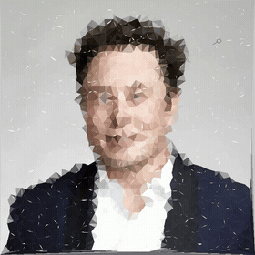
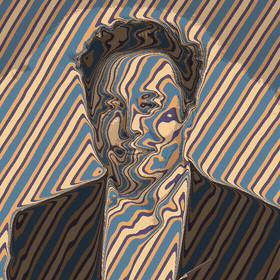

# ArtInMotion · 逐笔绘画工作室

[English](README.en.md) · [技能说明](SKILL.md) · [转场编号表](references/transitions.md)

**把一张照片画成一部 24 秒的短片。** 观众先看到成画，再回到纸面，看第一笔落在哪里、颜色如何一层层叠起来。ArtInMotion 从原照提取颜色、轮廓和笔触方向，在本机逐笔绘制，同时导出带声音的 MP4 和一张干净的成画。无需生图模型或 API Key。

[](demo/transition-atlas.mp4)

**[用马斯克肖像挑画风 · 20 种 / 30 秒](demo/musk-style-atlas.mp4)**　·　**[看完 68 种转场 · 60 秒](demo/transition-atlas.mp4)**　·　**[戴上耳机看一幅彩铅怎样画成 · 24 秒](demo/ribbon-portrait.mp4)**

## 按画风看 14 条完整版

先看同一张马斯克肖像在每种画风下怎样画成。点动图或画风名称，就能播放对应的 24 秒有声完整版。想用自己的照片试画，把编号填到 `--style` 即可。

<table>
  <tr>
    <td align="center">
      <a href="https://deaglepc.github.io/ArtInMotion/03-charcoal.mp4"><br><strong>03 · 黑白明暗素描</strong></a>
    </td>
    <td align="center">
      <a href="https://deaglepc.github.io/ArtInMotion/05-ink-wash.mp4"><br><strong>05 · 黑白水墨</strong></a>
    </td>
  </tr>
  <tr>
    <td align="center">
      <a href="https://deaglepc.github.io/ArtInMotion/07-gongbi.mp4"><br><strong>07 · 工笔设色与重彩</strong></a>
    </td>
    <td align="center">
      <a href="https://deaglepc.github.io/ArtInMotion/08-realist.mp4"><br><strong>08 · 细腻写实绘画</strong></a>
    </td>
  </tr>
  <tr>
    <td align="center">
      <a href="https://deaglepc.github.io/ArtInMotion/09-impasto.mp4"><br><strong>09 · 可见笔触与厚涂</strong></a>
    </td>
    <td align="center">
      <a href="https://deaglepc.github.io/ArtInMotion/10-pastel.mp4"><br><strong>10 · 干粉柔绘</strong></a>
    </td>
  </tr>
  <tr>
    <td align="center">
      <a href="https://deaglepc.github.io/ArtInMotion/11-crayon.mp4"><br><strong>11 · 蜡笔与油画棒</strong></a>
    </td>
    <td align="center">
      <a href="https://deaglepc.github.io/ArtInMotion/12-flat.mp4"><br><strong>12 · 平涂插画与漫画</strong></a>
    </td>
  </tr>
  <tr>
    <td align="center">
      <a href="https://deaglepc.github.io/ArtInMotion/13-woodcut.mp4"><br><strong>13 · 黑白刻印与剪影</strong></a>
    </td>
    <td align="center">
      <a href="https://deaglepc.github.io/ArtInMotion/15-stipple.mp4"><br><strong>15 · 点描与网点</strong></a>
    </td>
  </tr>
  <tr>
    <td align="center">
      <a href="https://deaglepc.github.io/ArtInMotion/16-collage.mp4"><br><strong>16 · 拼贴与镶嵌</strong></a>
    </td>
    <td align="center">
      <a href="https://deaglepc.github.io/ArtInMotion/18-marbling.mp4"><br><strong>18 · 流体与拓纹</strong></a>
    </td>
  </tr>
  <tr>
    <td align="center">
      <a href="https://deaglepc.github.io/ArtInMotion/19-facets.mp4"><br><strong>19 · 几何切面</strong></a>
    </td>
    <td align="center">
      <a href="https://deaglepc.github.io/ArtInMotion/20-pixel.mp4"><br><strong>20 · 像素与字符</strong></a>
    </td>
  </tr>
</table>

这 14 条影片及其预览动图均由 Duncan.Hull / The Royal Society 的肖像照片裁切、重绘而成，以 CC BY-SA 4.0 分享。[原照与署名](https://commons.wikimedia.org/wiki/File:Elon_Musk_Royal_Society.jpg) · [许可](https://creativecommons.org/licenses/by-sa/4.0/)

## 挑一个开场

同一张合照、同一幅成画，换一种进场和退场，直接看差别。视频上的编号可以直接交给技能使用。

| Demo | 时长 | 看什么 |
|---|---:|---|
| [68 种转场动态选片册](demo/transition-atlas.mp4) | 60 秒 | 每屏 4 种，17 屏看完全部。适合按编号挑进场和退场。 |
| [10 种绘画专用转场](demo/painting-transitions.mp4) | 31 秒 | 每次放大看一种，能看清水墨晕开的边缘、干刷的笔毛和翻页的投影。 |
| [绸带交错 · 彩铅有声成片](demo/ribbon-portrait.mp4) | 24 秒 | 横带引出双人肖像，回到纸面后，前四笔带铅笔声，快画段只留钢琴。 |
| [成画预览 · 直接切回白纸](demo/portrait-preview.mp4) | 24 秒 | 早期的直切样片，方便和绸带版对照开场节奏。 |

两种渲染模式都接受中文名、英文 ID 和编号。只点一种，进退场共用；分别点两种，可以让墨色晕开进场、柔焦退场。不指定时，每条视频从本机可用效果中随机选一种。共收录 10 种绘画专用效果和 58 种 FFmpeg 转场。[完整转场编号表](references/transitions.md)

## 在 Codex 里试一张照片

把照片和这段话一起发给能安装技能、执行本地命令的助手：

> 从 https://github.com/DeaglePC/ArtInMotion 安装技能并配置依赖。用 $art-in-motion 把我附的原照画成 24 秒彩铅视频，保留构图。03 号纸角翻页进场，08 号柔焦显影退场。开头几笔慢一点，最后给我 MP4 和 PNG。

## 在终端生成第一条视频

建议使用 Python 3.11 或 3.12。导出视频需要 PATH 中可用的 FFmpeg，带 libx264 和 AAC 编码器。仅导出静态图只需 Python 依赖。

```sh
git clone https://github.com/DeaglePC/ArtInMotion.git ~/.codex/skills/art-in-motion
cd ~/.codex/skills/art-in-motion
python -m venv .venv
source .venv/bin/activate
python -m pip install -r requirements.txt
```

Windows PowerShell 可将仓库克隆到本地技能目录，用 `.\.venv\Scripts\Activate.ps1` 激活环境。在仓库根目录运行以下命令，用自带底稿同时导出水彩视频和成画：

```sh
python scripts/render_art.py --input demo/jensen-huang.png --style watercolor --seconds 6 --size 480 --transition ink-bloom --transition-out focus --video renders/watercolor.mp4 --image renders/watercolor.png
```

打开 `renders/watercolor.mp4` 即可看片。下次把 `--input` 换成自己的照片；输出路径请使用新文件名。

## 同一张参考图，20 种画法

[](demo/musk-style-atlas.mp4)

**[播放 30 秒画风对照 MP4](demo/musk-style-atlas.mp4)** · [查看另一张参考图的 20 格静态总览](demo/styles.jpg)

同一张马斯克原照，同一裁切。每屏并排四种画法，先看成画，再看四幅肖像同步画出。**0:00** 看 01–04，**0:06** 看 05–08，**0:12** 看 09–12，**0:18** 看 13–16，**0:24** 看 17–20。喜欢哪一幅，就用它旁边的编号，例如 `--style 04` 选彩铅。

对照视频与动图使用 Duncan.Hull / The Royal Society 的《Elon Musk Royal Society.jpg》，经统一裁切、逐笔重绘和并排编排，衍生素材同以 CC BY-SA 4.0 分享。[原照及署名](https://commons.wikimedia.org/wiki/File:Elon_Musk_Royal_Society.jpg) · [CC BY-SA 4.0](https://creativecommons.org/licenses/by-sa/4.0/)

油画厚涂用笔触叠出体积，钢笔排线用线距表达明暗，拼贴则逐片放置色块。横照和竖照都会保留原构图，支持 PNG、JPEG 和 WebP 成画。

<details>
<summary>展开 20 种画风与命令行名称</summary>

| 编号 | 画法 | 命令中的名称 | 编号 | 画法 | 命令中的名称 |
|---|---|---|---|---|---|
|01|轮廓线描|contour|11|蜡笔与油画棒|crayon|
|02|密线排绘|hatching|12|平涂插画与漫画|flat|
|03|黑白明暗素描|charcoal|13|黑白刻印与剪影|woodcut|
|04|彩铅细绘|colored-pencil|14|套色版画|block-print|
|05|黑白水墨|ink-wash|15|点描与网点|stipple|
|06|透明水彩与彩墨|watercolor|16|拼贴与镶嵌|collage|
|07|工笔设色与重彩|gongbi|17|沙画与颗粒画|sand|
|08|细腻写实绘画|realist|18|流体与拓纹|marbling|
|09|可见笔触与厚涂|impasto|19|几何切面|facets|
|10|干粉柔绘|pastel|20|像素与字符（像素示例）|pixel|

</details>

用 `--list-styles` 列出画风，`--list-transitions` 列出当前 FFmpeg 支持的转场。默认视频为 24 秒、30 fps、长边 960 像素。成画预览和转场都计入总时长。

| 想调整什么 | 参数 |
|---|---|
| 开头六秒慢画，再逐渐加快 | `--opening-seconds 6` |
| 加浓颜料，或提高输出分辨率 | `--pigment 1.25`、`--size 1920` |
| 直接从白纸开始，或隐藏笔尖 | `--no-preview`、`--no-tool` |
| 只听绘画声、替换背景音乐、全片静音 | `--no-music`、`--music music.wav`、`--silent` |
| 固定笔触和配乐 | `--seed 42`；复现整个开场还需指定转场 |

彩铅的慢笔使用真实铅笔划纸录音，其他画风有各自的落笔、刷涂或材料放置音效。背景钢琴在本机合成。[彩铅录音与 CC0 授权](https://freesound.org/people/zakkolar/sounds/431438/)

## 经典竖屏油画与自定义画法

经典油画模式把镜头推近到人物细节，再拉回完整成画，带笔数计数和配乐。安装 Chromium（`python -m playwright install chromium`）后，在支持 WebGL 2 的环境运行。[观看经典油画 MP4](demo/jensen-huang.mp4) · [动图预览](demo/preview.gif) · [渲染说明](references/classic-oil.md)

要画书法、纹样或自定落笔顺序，可以编写 JSON 笔触计划，用 `--plan` 交给同一渲染器。[画法选择表](references/media.md) · [笔触计划格式](references/marks.md)

如果你想在下一张照片上试试不同画风，欢迎给 **ArtInMotion** 点一颗 **Star**，下次回来就能从选片册接着挑。
