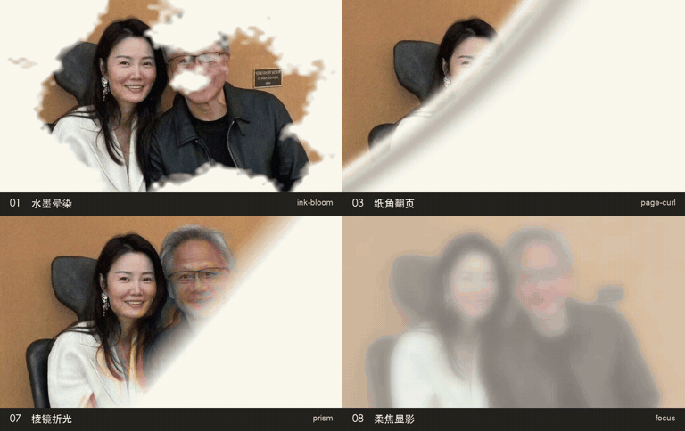
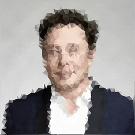
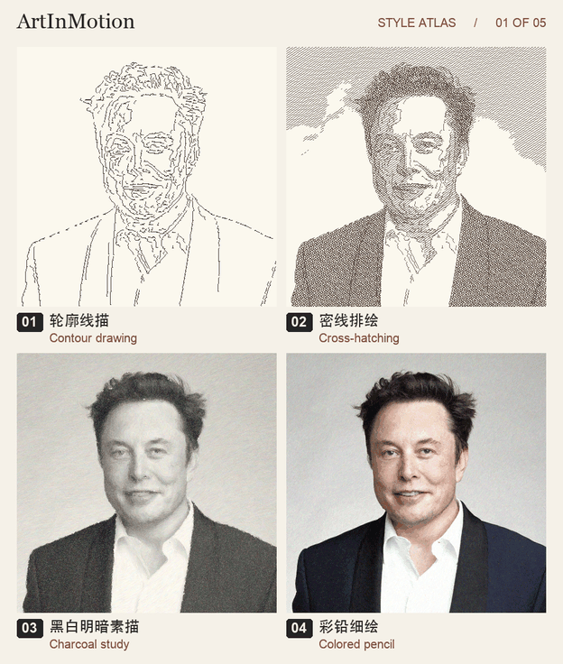
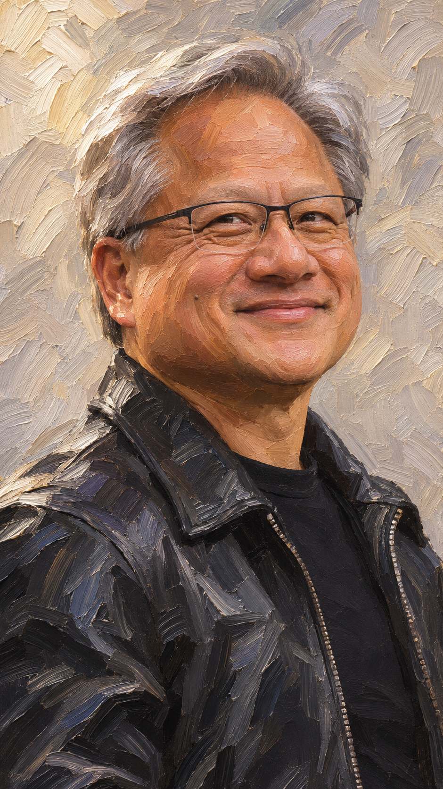

<div align="center">

<picture>
  <source media="(prefers-color-scheme: dark)" srcset="assets/banner-zh-dark.svg">
  <source media="(prefers-color-scheme: light)" srcset="assets/banner-zh-light.svg">
  
</picture>

<br>

[](https://deaglepc.github.io/ArtInMotion/)
[](#一图二十画--20-种画风全谱)
[](#挑一个开场--68-种转场选片)
[](#快速开始)
[](requirements.txt)

**[在线交互展厅](https://deaglepc.github.io/ArtInMotion/)** · **[English](README.en.md)** · **[快速开始](#快速开始)** · **[14 部有声成片](#按画风看-14-条有声完整版)** · **[20 种画风](#一图二十画--20-种画风全谱)** · **[68 种转场](#挑一个开场--68-种转场选片)** · **[3D 竖屏油画](#经典竖屏油画与自定义笔触)** · **[技能规范](SKILL.md)**

<br>

**把一张照片画成一部 24 秒的有声短片。**<br>
观众先凝视成画，再随转场回到纸面，看第一笔落在哪里、色彩如何一层层叠起。<br>
ArtInMotion 直接从原照提取轮廓、色相与笔触走向，在本机逐笔绘制，同步导出带配乐的 MP4 与干净的静态成画。

<br>

[](demo/transition-atlas.mp4)

**[马斯克同照 20 种画风 · 30 秒](demo/musk-style-atlas.mp4)**　·　**[68 种转场动态选片册 · 60 秒](demo/transition-atlas.mp4)**　·　**[戴上耳机听彩铅落纸与钢琴 · 24 秒](demo/ribbon-portrait.mp4)**　·　**[打开在线放映室 ↗](https://deaglepc.github.io/ArtInMotion/)**

</div>

---

## 为什么是 ArtInMotion

<table>
  <tr>
    <td width="50%" valign="top">
      <strong>纯本地算法落笔 · 零模型幻觉</strong><br>
      不调用生图大模型、无需任何 API Key。直接基于参考图的边缘曲率、明度梯度与色域采样计算每一笔路径，忠实保留人物神态与原照构图。
    </td>
    <td width="50%" valign="top">
      <strong>20 种媒材肌理 × 68 种进退场</strong><br>
      涵盖彩铅、水墨、工笔重彩、厚涂油画、木刻、点描、灯箱沙画等 20 种画法，搭配 10 种绘画专用转场（水墨晕染、纸角翻页、折扇等）与 58 种 FFmpeg 预设。
    </td>
  </tr>
  <tr>
    <td width="50%" valign="top">
      <strong>克制而考究的声画叙事</strong><br>
      开场先定格展示成画 1.2 秒，再翻回空白底纸；仅在慢画前 3 笔同步真实铅笔划纸或画笔刷涂声，抬笔即收，第 4 笔起由本机合成的钢琴独奏贯穿全片。
    </td>
    <td width="50%" valign="top">
      <strong>Agent 一句话调用 + 命令行可复现</strong><br>
      既可在 Codex / Claude Code / Antigravity 等助手中附照片直接对话生成，也支持 Python CLI 固定随机种子精确复现，或传入 JSON 笔触计划绘制书法与纹样。
    </td>
  </tr>
</table>

---

## 快速开始

### 方式一：在 AI 助手中用提示词生成（推荐）

在 Codex 或其他支持本地技能的助手里附上一张照片，复制下面这段提示词发送：

```text
请用 $art-in-motion 把我附的原照画成 24 秒的彩铅视频，保留原构图。
如果还没安装，请先从 https://github.com/DeaglePC/ArtInMotion 安装技能并配好依赖。
开头先展示成画，再转回白纸。绘制时让我看清笔尖，只有前三笔配铅笔声，之后只留钢琴。
完成后给我 MP4 视频和 PNG 成画。
```

> **连续试画技巧**：看中其他媒材时，直接追问 *「用同一张照片再画一版，换成 06 号透明水彩，颜色浓一点，水墨晕染开场」*；也可以前往 **[在线提示词工坊](https://deaglepc.github.io/ArtInMotion/#studio)** 点选画风与转场，一键生成专属指令。

<details>
<summary><strong>方式二：使用本地 Python 命令行直接渲染（点击展开）</strong></summary>

确保系统 `PATH` 中已安装带 `libx264` 与 `aac` 编码器的 **FFmpeg**，并使用 Python 3.11+ 创建虚拟环境：

```powershell
git clone https://github.com/DeaglePC/ArtInMotion.git
cd ArtInMotion
python -m venv .venv
.\.venv\Scripts\Activate.ps1
pip install -r requirements.txt

# 生成 24 秒彩铅有声视频 + 干净静态成画
python scripts/render_art.py --input "photo.jpg" --style colored-pencil --seconds 24 --video "output.mp4" --image "output.png"

# 查看全部 20 种画风与当前 FFmpeg 支持的转场编号
python scripts/render_art.py --list-styles
python scripts/render_art.py --list-transitions
```

</details>

---

## 按画风看 14 条有声完整版

同一张马斯克肖像，在 14 种不同媒材与底纸上逐笔成形。**点击任意动图或标题，即可直接播放对应的 24 秒有声完整版 MP4**；想在自己的照片上使用同款效果，直接告诉助手画风编号即可。

<table>
  <tr>
    <td align="center" width="25%">
      <a href="https://deaglepc.github.io/ArtInMotion/03-charcoal.mp4"><br><strong>03 · 黑白明暗素描</strong></a><br><sub><code>charcoal</code> · 炭笔纸纹</sub>
    </td>
    <td align="center" width="25%">
      <a href="https://deaglepc.github.io/ArtInMotion/05-ink-wash.mp4"><br><strong>05 · 黑白水墨</strong></a><br><sub><code>ink-wash</code> · 先淡后浓</sub>
    </td>
    <td align="center" width="25%">
      <a href="https://deaglepc.github.io/ArtInMotion/07-gongbi.mp4"><br><strong>07 · 工笔设色与重彩</strong></a><br><sub><code>gongbi</code> · 铺色勾线</sub>
    </td>
    <td align="center" width="25%">
      <a href="https://deaglepc.github.io/ArtInMotion/08-realist.mp4"><br><strong>08 · 细腻写实绘画</strong></a><br><sub><code>realist</code> · 层叠罩染</sub>
    </td>
  </tr>
  <tr>
    <td align="center" width="25%">
      <a href="https://deaglepc.github.io/ArtInMotion/09-impasto.mp4"><br><strong>09 · 可见笔触与厚涂</strong></a><br><sub><code>impasto</code> · 熟褐画布</sub>
    </td>
    <td align="center" width="25%">
      <a href="https://deaglepc.github.io/ArtInMotion/10-pastel.mp4"><br><strong>10 · 干粉柔绘</strong></a><br><sub><code>pastel</code> · 暖灰粉纸</sub>
    </td>
    <td align="center" width="25%">
      <a href="https://deaglepc.github.io/ArtInMotion/11-crayon.mp4"><br><strong>11 · 蜡笔与油画棒</strong></a><br><sub><code>crayon</code> · 蜡质粗笔</sub>
    </td>
    <td align="center" width="25%">
      <a href="https://deaglepc.github.io/ArtInMotion/12-flat.mp4"><br><strong>12 · 平涂插画与漫画</strong></a><br><sub><code>flat</code> · 色块墨线</sub>
    </td>
  </tr>
  <tr>
    <td align="center" width="25%">
      <a href="https://deaglepc.github.io/ArtInMotion/13-woodcut.mp4"><br><strong>13 · 黑白刻印与剪影</strong></a><br><sub><code>woodcut</code> · 深色木版减刻</sub>
    </td>
    <td align="center" width="25%">
      <a href="https://deaglepc.github.io/ArtInMotion/15-stipple.mp4"><br><strong>15 · 点描与网点</strong></a><br><sub><code>stipple</code> · 疏密成影</sub>
    </td>
    <td align="center" width="25%">
      <a href="https://deaglepc.github.io/ArtInMotion/16-collage.mp4"><br><strong>16 · 拼贴与镶嵌</strong></a><br><sub><code>collage</code> · 逐片落纸</sub>
    </td>
    <td align="center" width="25%">
      <a href="https://deaglepc.github.io/ArtInMotion/18-marbling.mp4"><br><strong>18 · 流体与拓纹</strong></a><br><sub><code>marbling</code> · 水拓流纹</sub>
    </td>
  </tr>
  <tr>
    <td align="center" width="25%">
      <a href="https://deaglepc.github.io/ArtInMotion/19-facets.mp4"><br><strong>19 · 几何切面</strong></a><br><sub><code>facets</code> · 多边形色面</sub>
    </td>
    <td align="center" width="25%">
      <a href="https://deaglepc.github.io/ArtInMotion/20-pixel.mp4"><br><strong>20 · 像素与字符</strong></a><br><sub><code>pixel</code> · 方格筑像</sub>
    </td>
    <td align="center" colspan="2" valign="middle">
      <strong><a href="https://deaglepc.github.io/ArtInMotion/">进入在线交互放映室 ↗</a></strong><br><br>
      <sub>在网页端沉浸式连播全部有声影片、按媒材分类筛选、<br>用放大镜检视 3D 油画肌理，并一键组合专属提示词与 CLI 命令。</sub>
    </td>
  </tr>
</table>

> <sub>以上 14 条影片及预览动图均由 Duncan.Hull / The Royal Society 拍摄的肖像照裁切、逐笔重绘而成，依 <a href="https://creativecommons.org/licenses/by-sa/4.0/">CC BY-SA 4.0</a> 协议分享 · <a href="https://commons.wikimedia.org/wiki/File:Elon_Musk_Royal_Society.jpg">查看原照与署名</a></sub>

---

## 一图二十画 · 20 种画风全谱

<div align="center">

[](demo/musk-style-atlas.mp4)

**[播放 30 秒画风四宫格对照 MP4](demo/musk-style-atlas.mp4)**　·　**[查看另一张参考图的 20 格静态总览](demo/styles.jpg)**

</div>

同一张马斯克原照，同一裁切，每屏并排四种画法同步落笔：
- **`0:00`** → `01–04`（轮廓线描 · 密线排绘 · 黑白素描 · 彩铅细绘）
- **`0:06`** → `05–08`（黑白水墨 · 透明水彩 · 工笔重彩 · 细腻写实）
- **`0:12`** → `09–12`（厚涂油画 · 干粉柔绘 · 蜡笔油画棒 · 平涂插画）
- **`0:18`** → `13–16`（木刻剪影 · 套色版画 · 点描网点 · 拼贴镶嵌）
- **`0:24`** → `17–20`（灯箱沙画 · 流体拓纹 · 几何切面 · 像素字符）

横照与竖照均自动保留原构图，成画支持导出为 **PNG、JPEG 或 WebP**。

<details>
<summary><strong>展开查看全部 20 种画风编号、命令 ID 与媒材说明</strong></summary>

| 编号 | 中文名称 | 命令行 ID | 模拟画具 / 底材 | 编号 | 中文名称 | 命令行 ID | 模拟画具 / 底材 |
|:---:|---|---|---|:---:|---|---|---|
| **01** | 轮廓线描 | `contour` | 钢笔长线 · 暖白画纸 | **11** | 蜡笔与油画棒 | `crayon` | 油画棒 · 粗颗粒留白 |
| **02** | 密线排绘 | `hatching` | 针管笔交叉排线 | **12** | 平涂插画与漫画 | `flat` | 平涂色块 + 轮廓墨线 |
| **03** | 黑白明暗素描 | `charcoal` | 炭条叠暗 · 保留纸纹 | **13** | 黑白刻印与剪影 | `woodcut` | 刻刀 · 深褐木版减刻 |
| **04** | 彩铅细绘 | `colored-pencil` | 彩铅顺形排线 + 真实划纸声 | **14** | 套色版画 | `block-print` | 油墨滚筒 · 分版套印 |
| **05** | 黑白水墨 | `ink-wash` | 毛笔 · 先淡后浓飞白留白 | **15** | 点描与网点 | `stipple` | 细笔 · 按明度分布点阵 |
| **06** | 透明水彩与彩墨 | `watercolor` | 水彩笔 · 半透明湿叠 | **16** | 拼贴与镶嵌 | `collage` | 剪纸色片 · 逐片贴合 |
| **07** | 工笔设色与重彩 | `gongbi` | 设色毛笔 · 分区渲染勾勒 | **17** | 沙画与颗粒画 | `sand` | 背光手影 · 暖光灯箱推沙 |
| **08** | 细腻写实绘画 | `realist` | 圆头画笔 · 渐进塑造体积 | **18** | 流体与拓纹 | `marbling` | 画针引流 · 水拓涡纹 |
| **09** | 可见笔触与厚涂 | `impasto` | 油画笔 · 熟褐画布厚涂 | **19** | 几何切面 | `facets` | 三角与多边形切面构成 |
| **10** | 干粉柔绘 | `pastel` | 色粉条 · 暖灰粉纸柔擦 | **20** | 像素与字符 | `pixel` | 方格色砖 · 秩序拼合 |

> 更多媒材变体（如红垩、银尖笔、丝网版画、彩窗、十字绣等）的映射建议，详见 [画法选择指南 (`references/media.md`)](references/media.md)。

</details>

---

## 挑一个开场 · 68 种转场选片

同一张合照、同一幅成画，换一种进场与退场，影片呼吸感截然不同。画面上的编号、中文名或英文 ID 均可直接传给渲染器。

| 样片名称 | 时长 | 观看重点 |
|---|---:|---|
| **[68 种转场动态选片册](demo/transition-atlas.mp4)** | 60 秒 | 每屏 4 种并排播放，17 屏看完全部 68 种，适合按编号快挑进退场。 |
| **[10 种绘画专用转场单屏精看](demo/painting-transitions.mp4)** | 31 秒 | 全画幅逐一演示：能看清水墨洇开的纤维边缘、干刷的飞白笔毛与纸角翻起的柔和投影。 |
| **[绸带交错 · 彩铅有声成片](demo/ribbon-portrait.mp4)** | 24 秒 | 横带交错引出双人肖像；回到纸面后前几笔伴随真实铅笔落纸声，延时段只留钢琴独奏。 |
| **[成画预览 · 直接切回白纸](demo/portrait-preview.mp4)** | 24 秒 | 早期直切对照样片，方便与绸带转场版对比开场节奏。 |

<details>
<summary><strong>查看 10 种绘画专用转场速查（编号 01–10）</strong></summary>

| 编号 | 中文名 | 命令行 ID | 视觉效果 | 编号 | 中文名 | 命令行 ID | 视觉效果 |
|:---:|---|---|---|:---:|---|---|---|
| **01** | 水墨晕染 | `ink-bloom` | 数处不规则墨团洇开汇成全画 | **06** | 绸带交错 | `ribbon` | 相邻横带从左右两侧交错滑入 |
| **02** | 干刷横扫 | `dry-brush` | 带细碎飞白刷毛的边缘横扫纸面 | **07** | 棱镜折光 | `prism` | 斜向光带掠过并短暂分离色散 |
| **03** | 纸角翻页 | `page-curl` | 卷边亮面与立体投影斜向翻过 | **08** | 柔焦显影 | `focus` | 从纸面淡入朦胧轮廓再缓缓合焦 |
| **04** | 镜头光圈 | `iris` | 六边形镜头光圈自画面中央展开 | **09** | 炭粉聚散 | `charcoal` | 细微炭粒在纸面聚拢显影 |
| **05** | 马赛克显影 | `mosaic` | 错落色块依次浮现拼合 | **10** | 折扇开合 | `silk-fan` | 扇骨自底边旋开依次露出画作 |

- 只传 `--transition ink-bloom` 时进退场共用同一效果；加传 `--transition-out focus` 可实现「水墨进场、柔焦退场」。
- 不指定参数时，每条视频自动从本机可用效果中随机挑选一种。编号 `11–68` 的全部 FFmpeg 转场详见 **[完整转场编号表 (`references/transitions.md`)](references/transitions.md)**。

</details>

---

## 经典竖屏油画与自定义笔触

<table>
  <tr>
    <td width="34%" align="center" valign="middle">
      <a href="demo/jensen-huang.mp4"></a><br>
      <sub><a href="demo/jensen-huang.mp4">▶ 播放 9:16 竖屏油画成片</a></sub>
    </td>
    <td width="30%" align="center" valign="middle">
      <a href="demo/jensen-huang.png"></a><br>
      <sub><a href="demo/jensen-huang.png">查看高清厚涂成画 PNG</a></sub>
    </td>
    <td width="36%" valign="middle">
      <h4>WebGL 3D 厚涂竖屏电影模式</h4>
      <p>独立脚本 <code>scripts/paint_video.py</code> 在熟褐色画布上计算六层曲线笔触，带立体油彩高光、实时落笔计数器与电影级推拉运镜。</p>
      <p>可直接对助手说：<br><em>「把这张照片做成经典竖屏油画，镜头推近眼睛，最后拉回全景。」</em></p>
      <p><a href="references/classic-oil.md">阅读竖屏油画渲染说明 →</a></p>
      <hr>
      <h4>自定义 JSON 笔触计划</h4>
      <p>想绘制书法、几何曼荼罗或精确控制每一笔落纸顺序，可编写 JSON 计划并通过 <code>--plan</code> 交由同一渲染引擎执行。<br><a href="references/marks.md">查看笔触计划格式 →</a></p>
    </td>
  </tr>
</table>

---

## 常用参数与声画说明

默认输出规格为 **24 秒 · 30 fps · 长边 960 像素**：视频默认带**木纹画板装裱**（纸本配美纹纸胶带、油画与木刻配画架托槽、沙画配灯箱木框），画幅方向与图片比例默认跟随原照完整保留；静态成画 `--image` 默认输出无边框的干净画作。

| 想要调整的效果 | 命令行参数 |
|---|---|
| 切换画板样式 / 关闭画板铺满全屏 / 静态图也带画板 | `--board tape\|clip\|easel\|clean`　·　`--no-board`　·　`--image-board` |
| 指定横屏（16:9）/ 竖屏（9:16）/ 方屏（1:1）画幅 | `--orientation landscape`（横屏）· `--orientation portrait`（竖屏）· `--orientation square` |
| 指定图片比例（智能显著性裁切或留白） | `--aspect 16:9\|9:16\|4:3\|3:4\|3:2\|2:3\|1:1`　·　`--fit pad`（不裁切留白） |
| 延长开头慢动作落笔时间（如前 6 秒慢画再加速） | `--opening-seconds 6` |
| 加浓透明媒材颜料饱和度 / 提升导出分辨率 | `--pigment 1.25`　·　`--size 1920` |
| 跳过开场成画预览直接从白纸起笔 / 隐藏画具笔尖 | `--no-preview`　·　`--no-tool` |
| 仅保留落笔声 / 替换自定义配乐 / 导出纯静音视频 | `--no-music`　·　`--music music.wav`　·　`--silent` |
| 精确复现笔触与钢琴配乐 | `--seed 42`（如需连开场一并复现，请同时显式指定 `--transition`） |

**关于声音设计**：新生成的影片仅在慢画开场的前三笔叠加真实绘画音效，笔尖抬离纸面即刻收声；从第四笔直至片尾定格，仅保留本机实时合成的轻柔钢琴独奏。彩铅采用真实铅笔划纸录音（[Freesound #431438 · CC0 公有领域授权](https://freesound.org/people/zakkolar/sounds/431438/)），其余媒材配备各自的毛笔刷涂或材料落位声。

---

## 致谢与许可

- 画风对照与 14 部完整演示影片基于 Duncan.Hull / The Royal Society 拍摄的 [*Elon Musk Royal Society.jpg*](https://commons.wikimedia.org/wiki/File:Elon_Musk_Royal_Society.jpg) 统一裁切与算法重绘，衍生演示素材遵循 **[CC BY-SA 4.0](https://creativecommons.org/licenses/by-sa/4.0/)** 共享。
- 如果你想在下一张照片上试试不同画风，欢迎前往 **[在线交互展厅 (deaglepc.github.io/ArtInMotion)](https://deaglepc.github.io/ArtInMotion/)** 挑片试玩，并给 **ArtInMotion** 点一颗 **Star** 收藏备用。
